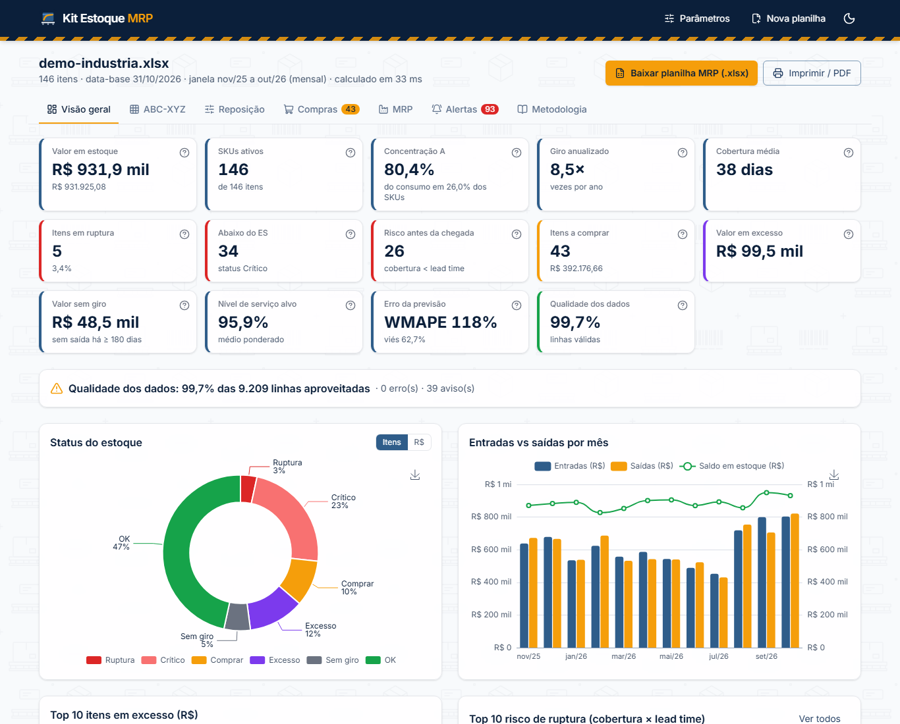
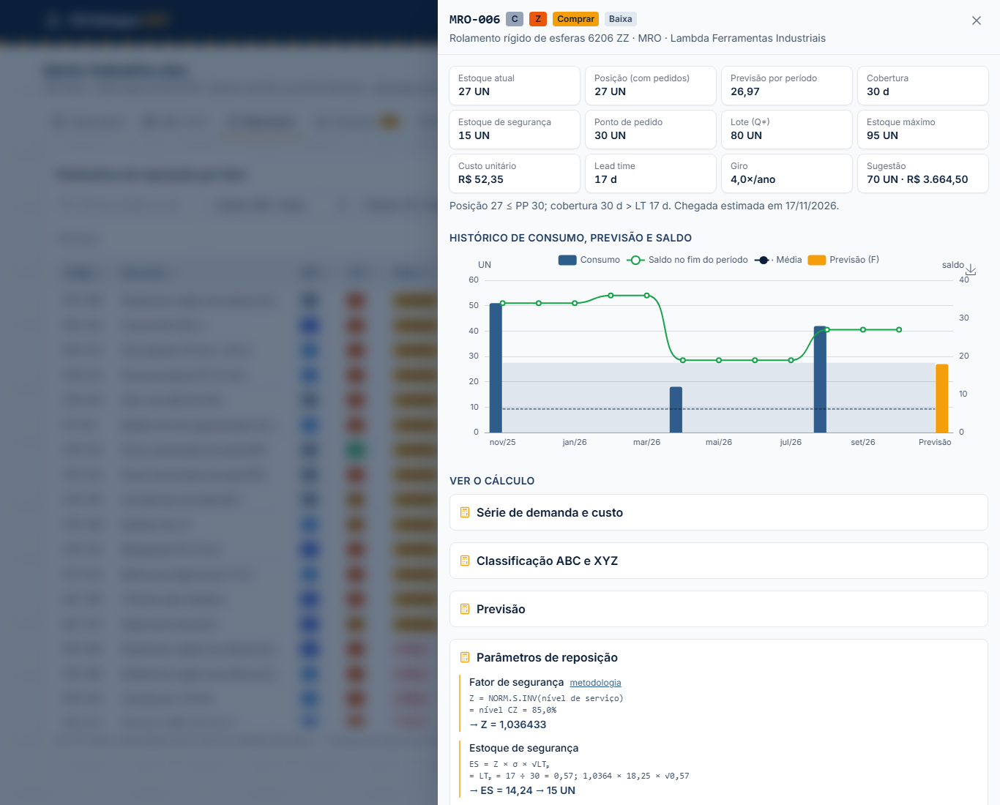

**English** · [Português](README.pt-BR.md)

<p align="center">
  
</p>

<p align="center">
  <a href="https://github.com/gorc-supply/kit-estoque-mrp/actions/workflows/deploy.yml"></a>
  <a href="LICENSE"></a>
  
</p>

# Kit Estoque MRP

Upload your inventory spreadsheet and get **ABC-XYZ analysis, replenishment parameters, purchase suggestions and MRP** in seconds — **free, and your data never leaves your computer**.

### 👉 [Try it now](https://gorc-supply.github.io/kit-estoque-mrp/) · [open it with sample data](https://gorc-supply.github.io/kit-estoque-mrp/?demo=industria)



## The problem it solves

Buyers and planners often decide **how much and when to buy** with a stock balance spreadsheet and a gut feeling. The classic methods (ABC analysis, safety stock, reorder point, economic order quantity, MRP) are in the textbooks, but building all of that in Excel for hundreds of items takes work, breaks easily and nobody checks the math.

Kit Estoque MRP does it from the export you already have (material master + stock movements), shows **every number with its formula and the values plugged in** ("Ver o cálculo", see the calculation) and returns a **ready-to-use Excel workbook** for day-to-day work.

## Features

- **ABC analysis** by annualized consumption value (alternatives by quantity and by stock value), **XYZ** by coefficient of variation and **Syntetos-Boylan demand pattern** (smooth, erratic, intermittent, lumpy), crossed in a clickable 3×3 matrix with a recommended policy per cell.
- **Multi-criteria ABC** (optional): combines value, lead time, criticality (of the item or of the equipment it serves), number of suppliers, substitute, downtime cost and the company's own criteria (`crit_*`) into a score weighted by percentile rank, or into the ABC × criticality (VED) matrix. Weight presets, sliders, **AHP assistant** with consistency ratio, floor rules, manual class with justification, **Sankey** "value → final", a "who changed class and why" table and class **stability** over 500 simulations. The final class then applies everywhere else.
- **Forecast** by moving average (smooth/erratic items) or **SBA — corrected Croston** (intermittent items), with **backtest** (MAE, RMSE, WMAPE, bias) and an automatic mode that picks the method with the lowest error.
- **Replenishment parameters** per item: safety stock (with or without lead time variability), reorder point, economic order quantity adjusted to minimum lot and pack size, maximum stock, coverage and turnover.
- **Purchase suggestions** with priority (urgent when coverage does not last through the lead time), total per supplier and export of only the selected rows.
- **Weekly MRP** (time-phased record like SAP's MD04): gross requirements, scheduled receipts, projected stock, net requirements, planned receipts and planned releases, with **late releases**. With BOM and MPS, it does **multi-level explosion** by low-level code, detects circular BOMs and checks the total against the **total requirements matrix** r = (I − B)⁻¹ d.
- **The math behind it**: total lot cost curve (derivative = 0 at the EOQ) and rounding penalty, lead time demand distribution and probability of running out before arrival, normal loss function and **fill rate**, service level × safety stock cost curve and cosine similarity between consumption profiles.
- **Data quality**: a report with each problem and its source row (code with no master record, invalid or future date, invalid quantity, unknown type, duplicates, negative reconstructed balance…).
- **Flexible column mapping**: recognizes synonyms ("cód.", "SKU", "qtde", "prazo de entrega"…) and, if needed, asks you to point to the columns — and remembers your choice.
- **Dashboard** with 14 clickable KPIs and 17 interactive charts (ECharts), light and dark mode, responsive on mobile.
- **Output workbook (.xlsx)** with 11 formatted sheets: Leia-me (read me), Dashboard (with the charts), ABC-XYZ, multi-criteria ABC, parameters, purchase suggestions, weekly and consolidated MRP, alerts, data quality and parameters used. It also exports CSV from any table and prints/saves to PDF.

| ABC-XYZ                                                  | MRP (dark mode)                                           |
| -------------------------------------------------------- | --------------------------------------------------------- |
|  |  |

| See the calculation                                                         | On mobile                                                                |
| --------------------------------------------------------------------------- | ------------------------------------------------------------------------ |
|  |  |

## Methodology in brief

Notation: d̄ = average demand per period, σ = sample standard deviation, F = forecast per period, LTₚ = lead time ÷ days per period, Z = NORM.S.INV(service level).

| Concept            | Formula                                                                                       |
| ------------------ | --------------------------------------------------------------------------------------------- |
| ABC analysis       | class by the **previous** cumulative % of annual consumption (A < 80%, B < 95%)               |
| XYZ                | CV = σ ÷ d̄ → X ≤ 0.50; Y ≤ 1.00; Z > 1.00                                                     |
| Syntetos-Boylan    | ADI = n ÷ periods with demand; CV² of non-zero sizes (cut-offs 1.32 and 0.49)                 |
| SBA                | F = (1 − α/2) · z ÷ p                                                                         |
| Safety stock       | ES = Z · σ · √LTₚ (or Z · √(LTₚσ² + F²σ_LTₚ²) with lead time variability)                     |
| Reorder point      | PP = F · LTₚ + ES                                                                             |
| Economic order qty | EOQ = √(2DS ÷ H), with H = i · cost; Q* = max(minimum lot, ⌈EOQ ÷ multiple⌉ · multiple)       |
| Maximum stock      | Máx = ES + Q*                                                                                 |
| Suggestion         | Qty = max(minimum lot, ⌈(Máx − position) ÷ multiple⌉ · multiple) when position ≤ PP           |
| Fill rate          | β = 1 − σ_LT · G(z) ÷ Q*, with G(z) = φ(z) − z(1 − Φ(z))                                      |
| Turnover           | (annualized consumption value) ÷ (reconstructed average stock × cost)                         |
| Multi-criteria ABC | S = Σ weightₖ × nₖ, with nₖ = percentile rank (position − 1) ÷ (n − 1); AHP with CR = CI ÷ RI |

The app's **Metodologia** (methodology) tab explains each formula with a numeric example, the implementation decisions and a glossary. The hand-calculated cases are in [`tests/`](tests).

## Input spreadsheet format

Download the **template spreadsheet** in the app (it has instructions, an example and drop-down lists). In short:

- **Materiais** (materials, required): `codigo`, `descricao`, `unidade`, `estoque_atual`, `lead_time_dias` + optional `custo_unitario`, `desvio_lead_time_dias`, `lote_minimo`, `multiplo_compra`, `estoque_seguranca_manual`, `fornecedor`, `categoria`, `tipo_item`, `data_cadastro`.
- **Movimentacoes** (stock movements, required): `data`, `codigo`, `tipo` (Entrada, Saída, Ajuste +, Ajuste -, Devolução ao estoque, Devolução ao fornecedor), `quantidade` + optional `valor_total`, `documento`. Only **Saída** (issue) counts as consumption.
- Optional: **PedidosAbertos** (open orders: `codigo`, `data_prevista`, `quantidade`), **BOM** (`codigo_pai`, `codigo_filho`, `quantidade_por`, `perda_pct`) and **MPS** (`codigo`, `semana_inicio`, `quantidade`).
- Multi-criteria ABC (all optional): columns `criticidade`, `num_fornecedores`, `possui_substituto`, `custo_parada_hora`, `classe_manual`, `justificativa_classe` and `crit_<name>` in Materiais, and the sheets **Equipamentos** (equipment: `equipamento`, `criticidade`, `setor`) and **OndeUsado** (where used: `codigo`, `equipamento`).

Accepts .xlsx or one .csv per sheet (separator `;` or `,`, UTF-8 or Windows-1252), Excel dates, dd/mm/yyyy or yyyy-mm-dd, and numbers in Brazilian format.

## Privacy

Everything runs **in your browser**, in a Web Worker: the spreadsheet is read and calculated locally and **is never sent to any server**. No backend, no database, no trackers, no cookies. The browser only stores preferences (parameters, theme and column mapping), never your data.

## Performance

Synthetic spreadsheet with **2,000 items and 100,000 movements** (3.4 MB): about **2.5 s** from upload to dashboard in Chrome on the development computer, without freezing the interface (longest pause measured: 33 ms). In Node, reading 1.7 s and calculation 0.3 s. To reproduce: `npx tsx scripts/gerar-volume.ts volume.xlsx`.

## Stack

Vite · React 19 · TypeScript (strict) · Tailwind CSS v4 · Apache ECharts · TanStack Table and Virtual · SheetJS Community Edition (reading) · ExcelJS (writing) · PapaParse · lucide-react · Inter (self-hosted) · Vitest · ESLint + Prettier · GitHub Actions + GitHub Pages. Only permissively licensed libraries (MIT, Apache-2.0, ISC); nothing loaded from a CDN at runtime.

## How to run locally

Requires Node.js 22 or newer.

```bash
npm install
npm run dev          # http://localhost:5173/kit-estoque-mrp/
npm test             # tests for the calculation engine, reading and export
npm run lint
npm run build        # generates dist/
npm run demo         # regenerates public/exemplos/*.xlsx (synthetic data, fixed seed)
```

Structure: `src/engine/` is the calculation engine in pure TypeScript (no React, no DOM), with a single entry point `processar(entrada, parametros)`. `src/io/` reads and writes spreadsheets, `src/worker/` runs everything off the interface thread, and `src/pages/` and `src/charts/` are the interface.

## Sample data

The spreadsheets in `public/exemplos/` are **100% synthetic** ("Metalúrgica Exemplo Ltda"), generated by `scripts/gerar-dados-demo.ts` with a fixed seed: ~150 items and 18 months of movements with a deliberate mix of demand patterns, stockouts, excess stock and some rows with errors, plus an assembly demo with a 3-level BOM and a 12-week MPS. The illustrations are original SVGs made for the project.

## Roadmap

- Explicit seasonality in the forecast (Holt-Winters) for items with 24+ months of history.
- Periodic review policy (R, S) as an alternative to the reorder point.
- Capacity constraints and supplier calendars in the MRP.
- Side-by-side comparison of two parameter scenarios.

## Author

Built by **Gabriel Cunha** — [LinkedIn](https://www.linkedin.com/in/gabriel-cunha-xp).

## License

[MIT](LICENSE).
