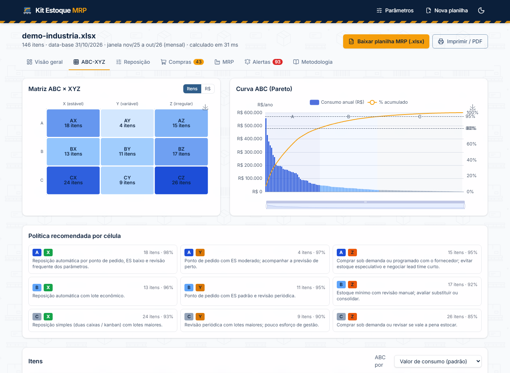
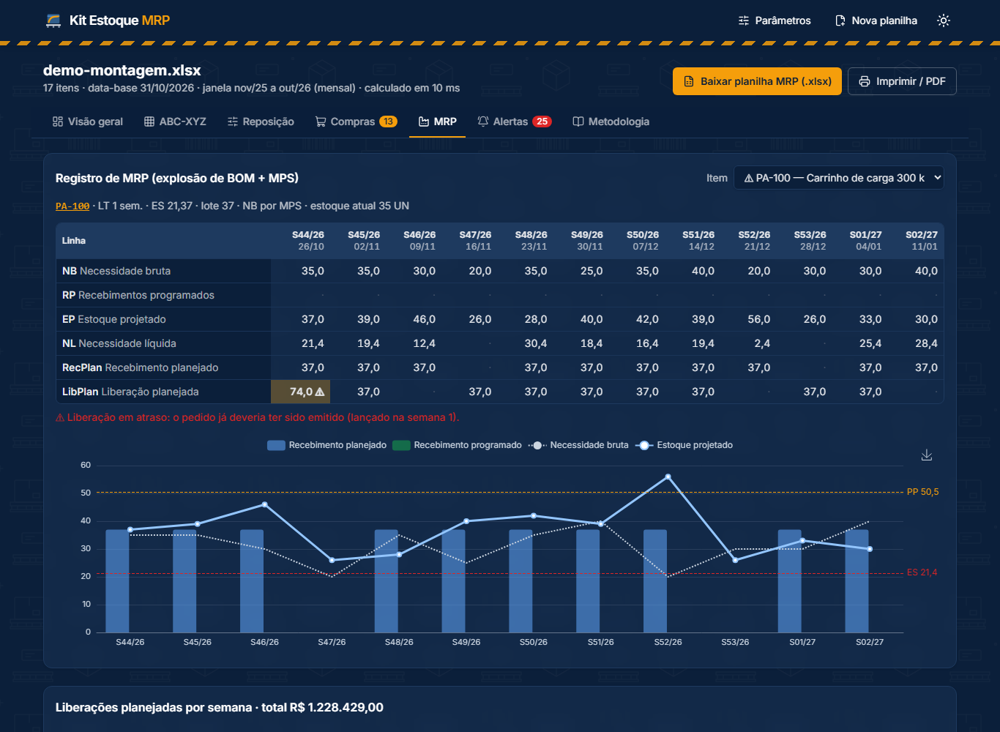
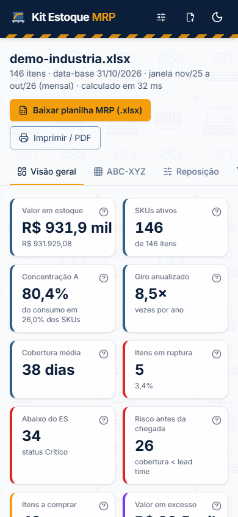

<p align="center">
  
</p>

<p align="center">
  <a href="https://github.com/gabriel-cunha-xp/kit-estoque-mrp/actions/workflows/deploy.yml"></a>
  <a href="LICENSE"></a>
  
</p>

# Kit Estoque MRP

Suba sua planilha de estoque e receba **curva ABC-XYZ, parâmetros de reposição, sugestão de compras e MRP** em segundos — **de graça e sem seus dados saírem do computador**.

### 👉 [Experimente agora](https://gabriel-cunha-xp.github.io/kit-estoque-mrp/) · [abrir já com dados de exemplo](https://gabriel-cunha-xp.github.io/kit-estoque-mrp/?demo=industria)


## O problema que resolve

Comprador e planejador costumam decidir **quanto e quando comprar** com uma planilha de saldo e um feeling. Os métodos clássicos (curva ABC, estoque de segurança, ponto de pedido, lote econômico, MRP) estão nos livros, mas montar tudo isso em Excel para centenas de itens dá trabalho, quebra fácil e ninguém confere a conta.

O Kit Estoque MRP faz isso a partir da exportação que você já tem (cadastro de materiais + movimentações), mostra **cada número com a fórmula e os valores substituídos** ("Ver o cálculo") e devolve uma **planilha Excel pronta** para o dia a dia.

## Funcionalidades

- **Curva ABC** por valor de consumo anualizado (alternativas por quantidade e por valor em estoque), **XYZ** pelo coeficiente de variação e **padrão de demanda de Syntetos-Boylan** (suave, errático, intermitente, irregular), cruzados numa matriz 3×3 clicável com política recomendada por célula.
- **Previsão** por média móvel (itens suaves/erráticos) ou **SBA — Croston corrigido** (intermitentes), com **backtest** (MAE, RMSE, WMAPE, viés) e modo automático que escolhe o método de menor erro.
- **Parâmetros de reposição** por item: estoque de segurança (com ou sem variabilidade de prazo), ponto de pedido, lote econômico ajustado a lote mínimo e embalagem, estoque máximo, cobertura e giro.
- **Sugestão de compras** com prioridade (urgente quando a cobertura não aguenta o lead time), total por fornecedor e exportação só das linhas selecionadas.
- **MRP semanal** (registro time-phased como no MD04 do SAP): necessidade bruta, recebimentos programados, estoque projetado, necessidade líquida, recebimento e liberação planejados, com **liberação em atraso**. Com BOM e MPS, faz a **explosão em vários níveis** por código de nível mais baixo, detecta BOM circular e confere o total com a **matriz de requisitos totais** r = (I − B)⁻¹ d.
- **A matemática por trás**: curva de custo total do lote (derivada = 0 no EOQ) e penalidade do arredondamento, distribuição da demanda no lead time e probabilidade de faltar antes da chegada, função de perda normal e **fill rate**, curva nível de serviço × custo do ES e similaridade de cosseno entre perfis de consumo.
- **Qualidade dos dados**: relatório com cada problema e a linha de origem (código sem cadastro, data inválida ou futura, quantidade inválida, tipo desconhecido, duplicidades, saldo reconstruído negativo…).
- **Mapeamento flexível de colunas**: reconhece sinônimos ("cód.", "SKU", "qtde", "prazo de entrega"…) e, se precisar, pede para você apontar as colunas — e lembra da escolha.
- **Dashboard** com 14 KPIs clicáveis e 17 gráficos interativos (ECharts), modo claro e escuro, responsivo no celular.
- **Planilha de saída (.xlsx)** com 10 abas formatadas: Leia-me, Dashboard (com os gráficos), ABC-XYZ, parâmetros, sugestão de compras, MRP semanal e consolidado, alertas, qualidade dos dados e parâmetros usados. Também exporta CSV de qualquer tabela e imprime/salva em PDF.

| ABC-XYZ                                                   | MRP (modo escuro)                                               |
| --------------------------------------------------------- | --------------------------------------------------------------- |
|  |  |

| Ver o cálculo                                                                | No celular                                                                |
| ---------------------------------------------------------------------------- | ------------------------------------------------------------------------- |
|  |  |

## Metodologia resumida

Notação: d̄ = demanda média por período, σ = desvio padrão amostral, F = previsão por período, LTₚ = lead time ÷ dias por período, Z = NORM.S.INV(nível de serviço).

| Conceito             | Fórmula                                                                                 |
| -------------------- | --------------------------------------------------------------------------------------- |
| Curva ABC            | classe pelo % acumulado **anterior** do consumo anual (A < 80%, B < 95%)                |
| XYZ                  | CV = σ ÷ d̄ → X ≤ 0,50; Y ≤ 1,00; Z > 1,00                                               |
| Syntetos-Boylan      | ADI = n ÷ períodos com demanda; CV² dos tamanhos não nulos (cortes 1,32 e 0,49)         |
| SBA                  | F = (1 − α/2) · z ÷ p                                                                   |
| Estoque de segurança | ES = Z · σ · √LTₚ (ou Z · √(LTₚσ² + F²σ_LTₚ²) com variabilidade de prazo)               |
| Ponto de pedido      | PP = F · LTₚ + ES                                                                       |
| Lote econômico       | EOQ = √(2DS ÷ H), com H = i · custo; Q* = max(lote mínimo, ⌈EOQ ÷ múltiplo⌉ · múltiplo) |
| Estoque máximo       | Máx = ES + Q*                                                                           |
| Sugestão             | Qtd = max(lote mínimo, ⌈(Máx − posição) ÷ múltiplo⌉ · múltiplo) quando posição ≤ PP     |
| Fill rate            | β = 1 − σ_LT · G(z) ÷ Q*, com G(z) = φ(z) − z(1 − Φ(z))                                 |
| Giro                 | (consumo em valor anualizado) ÷ (estoque médio reconstruído × custo)                    |

A aba **Metodologia** do app explica cada fórmula com exemplo numérico, as decisões de implementação e um glossário. Os casos calculados à mão estão em [`tests/`](tests) (101 testes).

## Formato da planilha de entrada

Baixe a **planilha-modelo** no app (tem instruções, exemplo e listas suspensas). Em resumo:

- **Materiais** (obrigatória): `codigo`, `descricao`, `unidade`, `estoque_atual`, `lead_time_dias` + opcionais `custo_unitario`, `desvio_lead_time_dias`, `lote_minimo`, `multiplo_compra`, `estoque_seguranca_manual`, `fornecedor`, `categoria`, `tipo_item`, `data_cadastro`.
- **Movimentacoes** (obrigatória): `data`, `codigo`, `tipo` (Entrada, Saída, Ajuste +, Ajuste -, Devolução ao estoque, Devolução ao fornecedor), `quantidade` + opcionais `valor_total`, `documento`. Só **Saída** conta como consumo.
- Opcionais: **PedidosAbertos** (`codigo`, `data_prevista`, `quantidade`), **BOM** (`codigo_pai`, `codigo_filho`, `quantidade_por`, `perda_pct`) e **MPS** (`codigo`, `semana_inicio`, `quantidade`).

Aceita .xlsx ou um .csv por aba (separador `;` ou `,`, UTF-8 ou Windows-1252), datas do Excel, dd/mm/aaaa ou aaaa-mm-dd, e números no formato brasileiro.

## Privacidade

Tudo roda **no seu navegador**, num Web Worker: a planilha é lida e calculada localmente e **nunca é enviada a nenhum servidor**. Sem backend, sem banco de dados, sem rastreadores, sem cookies. O navegador guarda apenas preferências (parâmetros, tema e o mapeamento de colunas), nunca os seus dados.

## Desempenho

Planilha sintética com **2.000 itens e 100.000 movimentações** (3,4 MB): cerca de **2,5 s** do envio ao dashboard no Chrome do computador de desenvolvimento, sem travar a interface (maior pausa medida: 33 ms). No Node, leitura 1,7 s e cálculo 0,3 s. Para reproduzir: `npx tsx scripts/gerar-volume.ts volume.xlsx`.

## Stack

Vite · React 19 · TypeScript (strict) · Tailwind CSS v4 · Apache ECharts · TanStack Table e Virtual · SheetJS Community Edition (leitura) · ExcelJS (escrita) · PapaParse · lucide-react · Inter (self-hosted) · Vitest · ESLint + Prettier · GitHub Actions + GitHub Pages. Somente bibliotecas de licença permissiva (MIT, Apache-2.0, ISC); nada carregado de CDN em tempo de execução.

## Como rodar localmente

Requer Node.js 22 ou mais recente.

```bash
npm install
npm run dev          # http://localhost:5173/kit-estoque-mrp/
npm test             # testes do motor de cálculo, leitura e exportação
npm run lint
npm run build        # gera dist/
npm run demo         # regera public/exemplos/*.xlsx (dados sintéticos, semente fixa)
```

Estrutura: `src/engine/` é o motor de cálculo em TypeScript puro (sem React, sem DOM), com uma única entrada `processar(entrada, parametros)`. `src/io/` lê e escreve planilhas, `src/worker/` roda tudo fora da thread da interface, e `src/pages/` e `src/charts/` são a interface.

## Dados de exemplo

As planilhas em `public/exemplos/` são **100% sintéticas** ("Metalúrgica Exemplo Ltda"), geradas por `scripts/gerar-dados-demo.ts` com semente fixa: ~150 itens e 18 meses de movimentações com mistura proposital de padrões de demanda, rupturas, excessos e algumas linhas com erro, além de uma demo de montagem com BOM de 3 níveis e MPS de 12 semanas. As ilustrações são SVGs originais criados para o projeto.

## Roadmap

- Sazonalidade explícita na previsão (Holt-Winters) para itens com histórico de 24+ meses.
- Política de revisão periódica (R, S) como alternativa ao ponto de pedido.
- Restrição de capacidade e calendário de fornecedores no MRP.
- Comparação entre dois cenários de parâmetros lado a lado.

## Autor

Desenvolvido por **Gabriel Cunha** — [LinkedIn](https://www.linkedin.com/in/gabriel-cunha-xp).

## Licença

[MIT](LICENSE).
